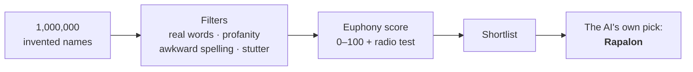

# company-name

**The invented-word generator that named Rapalon™.**

An open-source project by Rapalon Labs, Inc., released under the [MIT License](LICENSE).

A Python library and command-line tool that invents words that don't exist yet, but sound natural and pleasant to American English speakers. It is built for brand and company names, product names and fantasy worldbuilding: every candidate is pronounceable, is not a real English word, and contains nothing offensive.

```bash
uv run company-name --count 5 --preset soft --seed 7
```

```text
Spelling | Respelling  | IPA        | Syllables | Preset | Score
---------+-------------+------------+-----------+--------+------
Ritona   | REE-tah-nuh | /ˈɹitɑnə/  | ri.to.na  | soft   |    92
Karola   | KAY-rah-luh | /ˈkeɪɹɑlə/ | ka.ro.la  | soft   |    91
Ruberu   | ROO-buh-roo | /ˈɹubəɹu/  | ru.be.ru  | soft   |    90
Tima     | TEE-muh     | /ˈtimə/    | ti.ma     | soft   |    89
Doro     | DOR-oh      | /ˈdɔɹoʊ/   | do.ro     | soft   |    89
```

---

## How Rapalon got its name

When I set out to find a name for our company, I didn't open a thesaurus or hire a naming agency. I asked an AI to generate **a million invented names** (words that exist in no dictionary) and then to weed out every one that didn't work.

Most of this repository is about the weeding. A name was thrown out if it:

- turned out to be a real English word;
- contained a profanity or a slur, even one hidden inside the word or spelled in leetspeak;
- had clumsy spelling, such as three consonants in a row, odd doubled vowels or an ambiguous `c`;
- stuttered (`Mimi`, `Koko`), or was too short or too long.

The survivors were ranked by a 0–100 euphony score, which rewards open syllables, melodic consonants and natural English stress. It also includes a "radio test": can you say the name over a bad phone line and have the other person spell it right the first time?



The final call was left to the AI as well. From everything that made it through, it chose one word: **Rapalon**. That is how our company, Rapalon Labs, got its name.

This is the audit the tool gives the name today:

```bash
uv run company-name --test Rapalon
```

```text
====================================================================
          WORD AUDIT REPORT: RAPALON
====================================================================

PHONOLOGICAL PROFILE:
  • Spelling:          Rapalon
  • Syllable Split:    ra.pa.lon (3 syllables)
  • Respelling:        RA-puh-lohn
  • IPA Transcription: /ˈɹæpəloʊn/
  • Stress Pattern:    Antepenultimate (1st syllable stressed - natural English cadence)

QUALITY & SAFETY FILTERS: [PASSED]
  [✓] Real English Word    Novel invented word (not in English dictionary)
  [✓] Profanity & Slurs    Clean (no offensive terms or leetspeak variants)
  [✓] Letter Sequences     Fluid, standard American English orthography
  [✓] Reduplication        No repetitive syllable stuttering
  [✓] Length Limits        7 letters (recommended sweet spot: 4–9 letters)

EUPHONY SCORE: 86 / 100  [VERY GOOD (A)]
  [██████████████████████████░░░░]  86%
  • Open Syllables:       13.3 / 20.0
  • Sonorant Density:     12.0 / 16.0
  • Cluster Penalty:       0.0 / -8.0
  • Stress Rhythm:        14.0 / 14.0
  • Length Bonus:          9.5 / 10.0
  • Memorability:          8.0 /  8.0
  • Bigram Fluency:       13.0 / 16.0
  • Radio Test:           16.0 / 16.0

RADIO TEST DIAGNOSTICS (Telephone Intelligibility & Spelling Clarity):
  • Radio Score:          16.0 / 16.0
  • Verdict:              Clear & transparent: high likelihood of immediate, accurate transcription
  • Strengths:
      + Unambiguous plosives ('K', 'T', 'P', 'D', 'B') with no C/K confusion
      + No 'M' vs 'N' nasal confusion over low-bandwidth audio

BRAND FEEL & SOUND SYMBOLISM:
  • Profile:              Soft & Smooth (Warm, friendly, human, organic, gentle)
  • Balance:              75% Soft / 25% Crisp

OVERALL VERDICT:
  Strong, natural-sounding name with good phonetic balance and high pronounceability.
====================================================================
```

All five filters pass, and it gets a perfect radio-test score: a listener hears exactly how to spell it.

<details>
<summary>Generate your own million</summary>

The library is fast enough to run the whole experiment in about half a minute. With the `balanced` preset and seed `2026`, a million raw candidates give roughly 470,000 unique words that pass every filter.

```python
import random

from company_name.filters import WordFilter
from company_name.presets import get_preset
from company_name.spelling_mapper import render_syllables_to_spelling
from company_name.syllable_builder import SyllableBuilder

rng = random.Random(2026)
builder = SyllableBuilder(get_preset("balanced"), rng=rng)
word_filter = WordFilter()

survivors = set()
for _ in range(1_000_000):
    syllables = builder.build_word(builder.choose_syllable_count())
    spelling, _ = render_syllables_to_spelling(syllables, rng=rng)
    if word_filter.is_valid(spelling, syllables=syllables)[0]:
        survivors.add(spelling)

print(len(survivors))
```

</details>

---

## Quick start

Requires Python 3.12+. The recommended way to run the tool is with [uv](https://docs.astral.sh/uv/):

```bash
git clone https://github.com/rapalon/word_generator.git
cd word_generator
uv run company-name --count 10
```

Without uv:

```bash
pip install .
company-name --count 10
# or
python -m company_name --count 10
```

The package has no runtime dependencies beyond the Python standard library.

---

## How it works: sounds first, spelling second

Naive name generators glue together random letters or n-grams. This one works with **phonemes and syllables**, the way a linguist would:

1. **Build syllables** from American English phonotactics, weighted towards sounds people find pleasant.
2. **Assign stress**: trochaic rhythm (`MAR-lo`) by default, the Latin penultimate rule for heavy middle syllables (`ka-NO-la`).
3. **Reduce vowels**: unstressed vowels relax to schwa `/ə/`, as they do in natural speech.
4. **Spell it**: map the sounds to the least ambiguous American English spelling.

Every word comes with three synchronized forms:

| Form | Example |
|------|---------|
| Spelling | `Lumora` |
| Pronunciation respelling (stress in caps) | `loo-MOR-uh` |
| IPA | `/luˈmɔɹə/` |

### Phonological rules

The rules draw on David Crystal's work on phonaesthetics, Cutler & Carter on English stress patterns, and research on processing fluency.

- **Length**: mostly 2–3 syllables (default: 50% two, 45% three, 5% one or four); 4–9 letters.
- **Open syllables**: at least 70% of syllables are open (CV). Closed syllables appear mainly at the end of the word, or as a sonorant before the next onset (`Kal-vin`).
- **Consonant weights**: soft, melodic `l m n r` are most frequent; `s v d b k t` come next; `p g f z h y w` are rarer. `th`, `ng` and `zh` never start a syllable, and `x` only ends one, rarely.
- **Clusters**: at most one per word, only from easy English onsets (`bl br cl cr dr fl fr gl gr pl pr tr st sl`). Never three consonants in a row, never complex codas.
- **Vowels**: clear, stable American vowels with predictable spellings. Ambiguous spellings like `ough`, `eau`, `aw` and `ou` are never produced.
- **Name-like endings**: a bias towards `-a -o -i -y -en -an -on -el -ar -is`.
- **Memorability**: every word contains at least one plosive (`k t p b d g`) and one sonorant (`l m n r`).

### Sound-symbolism presets

| Preset | Character |
|--------|-----------|
| `balanced` (default) | A mix of melodic sonorants and crisp plosives. |
| `soft` | More `m l n b` and rounded back vowels (`o u a`): smooth, warm, gentle. |
| `crisp` | More `k t p s z` and front vowels (`i e`): sharp, quick, tech-oriented. |
| `tolkien` / `elvish` | Modelled on the phonaesthetics of Quenya and Sindarin: ringing sonorants, clean `d t`, liquid clusters (`gl fl dr tr`), open Italianate vowels. Ancient, noble, poetic. |
| `custom` | Your own weights and limits from a TOML or JSON file. |

A custom preset only needs the keys you want to change; everything else falls back to `balanced`. See [example_custom.toml](example_custom.toml):

```toml
# Top-level options
cluster_probability = 0.10
min_length = 4
max_length = 8
require_memorability = true

[consonant_weights]
l = 6.0
m = 5.0
n = 4.0
r = 4.0
v = 3.0
b = 2.0
k = 0.5
t = 0.5
p = 0.5

[vowel_weights]
OW = 5.0
UW = 4.0
AA = 3.0
AX = 3.0
IY = 2.0

[syllable_distribution]
2 = 0.70
3 = 0.30
```

```bash
uv run company-name --preset custom --config example_custom.toml
```

Vowels use ARPAbet keys: `AE EH IH AA AH IY EY OW UW AX`. Other supported keys are `cluster_weights`, `open_syllable_target_min` and `allow_reduplication`.

### Quality filters

A candidate is rejected if it fails any of these:

1. **Real word**: it is one of the ~315,000 words in the bundled English word list (turn this off with `--allow-real-words`).
2. **Profanity and slurs**: it contains an offensive term anywhere inside it, including leetspeak (`b1tch`) and stretched spellings (`shiiit`).
3. **Awkward letters**: it has a doubled vowel other than `ee`/`oo`, `wh` after the first letter, three consonants in a row, a final `c`, an initial `x`, or a soft-`c` (`ce`, `ci`, `cy`).
4. **Reduplication**: it repeats a syllable back to back, as in `Mimi` or `Lolo`.
5. **Length**: it falls outside the preset's letter range (4–9 by default).

### Euphony score (0–100)

| Component | Points | What it measures |
|-----------|-------:|------------------|
| Open syllables | 20 | Share of open CV syllables |
| Sonorant density | 16 | Share of `l m n r` among consonants |
| Cluster penalty | −8 | Applied if the word has a consonant cluster |
| Stress rhythm | 14 | Trochaic first-syllable stress, or penultimate stress on a heavy syllable |
| Length | 10 | Two or three syllables is the sweet spot |
| Memorability | 8 | Has both a plosive and a sonorant |
| Bigram fluency | 16 | How English-like the letter pairs are, from bigram log-probabilities of an English word list |
| Radio test | 16 | Telephone intelligibility and spelling transparency |

The **radio test** imagines the name being said over a 300–3400 Hz phone line. It penalizes a `c` ("C or K?"), a final `y`/`ee` ("I, Y or double E?"), doubled vowels, `x`, words with both `m` and `n` ("M as in Mary or N as in Nancy?"), confusable pairs like `b`/`v`, `p`/`b` and `t`/`d`, and clusters that codecs tend to clip. Clear open endings (`-a`, `-o`) earn a bonus.

---

## CLI reference

| Flag | Description | Default |
|------|-------------|---------|
| `--count`, `-c` | Number of words to output | `20` |
| `--preset`, `-p` | `balanced`, `soft`, `crisp`, `tolkien`, `elvish`, `custom` | `balanced` |
| `--config` | TOML or JSON file for the `custom` preset | — |
| `--syllables`, `-s` | Exact count (`2`) or range (`2-3`) | sampled from the preset |
| `--starts-with` | Keep only words starting with these letters | — |
| `--ends-with` | Keep only words ending with these letters | — |
| `--min-score` | Minimum euphony score (0–100) | `0` |
| `--seed` | Random seed for reproducible output | — |
| `--format`, `-f` | `table`, `json`, `csv`, `words`, `lines` | `table` |
| `--words-only`, `-w` | Words only, comma-separated | off |
| `--lines`, `-l` | Words only, one per line (handy for piping) | off |
| `--test`, `-t`, `--analyze` | Audit a single word through every check | — |
| `--allow-real-words` | Don't reject existing English words | off |

Results are ranked by score, best first. The same `--seed` with the same options always gives the same words.

### Examples

Words only:

```bash
uv run company-name --seed 7 -c 10 -w
```

```text
Nuraba, Ranoti, Gelo, Temo, Dilari, Tirana, Dina, Moto, Bila, Pirili
```

One per line, ready to save as a shortlist:

```bash
uv run company-name --seed 7 -c 200 -l > names.txt
```

Names with a given beginning and ending:

```bash
uv run company-name --starts-with Ra --ends-with on --seed 7 -w
```

```text
Ratovon, Ragimon, Rablon
```

Different presets, same seed:

```bash
uv run company-name --preset tolkien --seed 7 -c 10 -w
# Laridi, Pilola, Galara, Kalara, Delo, Doma, Mopo, Nemeko, Gima, Laba

uv run company-name --preset crisp --seed 7 -c 10 -w
# Geno, Miga, Dalu, Rapa, Umay, Niko, Talay, Deree, Pinee, Peleca
```

JSON with the full score breakdown:

```bash
uv run company-name --seed 7 -c 1 --format json
```

```json
[
  {
    "spelling": "Nuraba",
    "respelling": "NUH-ruh-buh",
    "ipa": "/ˈnʌɹəbə/",
    "syllable_breakdown": "nu.ra.ba",
    "preset": "balanced",
    "score": 90,
    "score_details": {
      "open_syllables": 20.0,
      "sonorants": 10.7,
      "cluster_penalty": 0.0,
      "stress_pattern": 14.0,
      "length_bonus": 9.5,
      "memorability": 8.0,
      "pronounceability": 11.8,
      "radio_test": 16.0
    }
  }
]
```

`--test` also accepts `--format json` and returns the whole audit in machine-readable form.

---

## Python API

```python
from company_name import WordAnalyzer, WordGenerator

generator = WordGenerator(preset_name="soft", seed=42)
for word in generator.generate(count=5, syllables="2-3", min_score=80):
    print(f"{word.spelling:10} | {word.respelling:12} | {word.ipa:12} | Score: {word.score}")

report = WordAnalyzer().analyze("Rapalon")
print(report.score.total, report.rating_label)  # 86 VERY GOOD (A)
```

```text
Ponelo     | PAH-nuh-loh  | /ˈpɑnəloʊ/   | Score: 91
Poromu     | PAR-ah-moo   | /ˈpɑɹɑmu/    | Score: 90
Rilogi     | REE-lah-gee  | /ˈɹilɑɡi/    | Score: 90
Timona     | TIH-mah-nuh  | /ˈtɪmɑnə/    | Score: 90
Ganara     | guh-NAY-ruh  | /ɡəˈneɪɹə/   | Score: 89
```

`WordGenerator` also accepts a ready-made `GeneratorConfig`, custom `ScorerWeights`, `allow_real_words` and `allow_reduplication`.

---

## Checking that a name is free

A beautiful name is no use if someone already owns it. [check_names.py](check_names.py) takes a shortlist, one name per line (blank lines and `#` comments are ignored), and checks for each name:

- whether a GitHub user or organization with that login exists (via GraphQL, 50 names per request);
- whether `<name>.com` is registered, asked directly of the Verisign `.com` registry over RDAP;
- with `--labs`, whether `<name>labs.com` is registered too.

```bash
export GITHUB_TOKEN=<any token, no scopes needed>   # or just be logged in with `gh`
python check_names.py names.txt                     # writes results.csv
python check_names.py names.txt --labs -o out.csv
```

Without a token, the script falls back to the REST API, which GitHub limits to 60 requests per hour. It needs only the standard library and finishes by listing the names that are free on both GitHub and `.com`.

---

## Project layout

```text
src/company_name/
├── phonemes.py          consonant and vowel inventories, cluster whitelist, name endings
├── syllables.py         syllable model: openness, weight, IPA
├── syllable_builder.py  builds phonologically legal syllable sequences
├── stress.py            stress assignment and vowel reduction
├── spelling_mapper.py   sounds → spelling, respelling and IPA
├── filters.py           real-word, profanity and letter-sequence filters
├── scorer.py            0–100 euphony score and radio test
├── analyzer.py          single-word audit (--test)
├── presets.py           built-in presets and TOML/JSON loader
├── generator.py         WordGenerator: generate → filter → score → rank
├── cli.py               command-line interface and output formats
└── data/                English word list and letter-bigram statistics
check_names.py           GitHub and .com availability checker
tests/                   pytest suite
```

## Running the tests

```bash
uv run pytest
```

The 46 tests cover syllable structure, cluster limits, stress placement, spelling, filters, scoring, presets, seed reproducibility, the analyzer and the CLI.

## License

The code is released under the [MIT License](LICENSE). Copyright © 2026 Rapalon Labs, Inc.

## Trademark

Rapalon™ is a trademark of Rapalon Labs, Inc. The MIT License applies to the source code in this repository only. It does not grant permission to use the Rapalon name, logos or other trademarks of Rapalon Labs, Inc., except as reasonably needed to describe the origin of the software.
